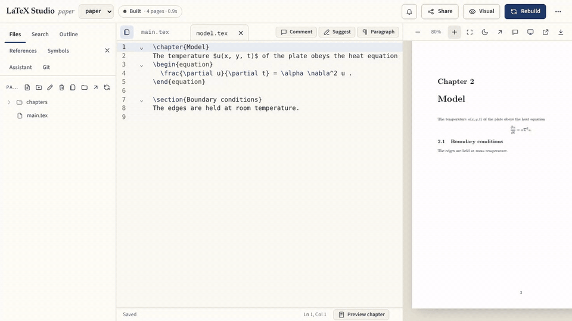

# LaTeX Document Pipeline

[](https://github.com/NotTahaAli/LatexPipeline/actions/workflows/build-pdf.yml)
[](https://github.com/NotTahaAli/LatexPipeline/actions/workflows/lint.yml)
[](https://github.com/NotTahaAli/LatexPipeline/releases/tag/pdfs)

A cross-platform build script, a browser editor with live preview, and a GitHub Actions workflow that publishes every document's PDF to a release.



Each folder under `files/` with a `main.tex` is one document:

```text
files/abc/main.tex            ->  out/abc.pdf
files/reports/final/main.tex  ->  out/reports/final.pdf
```

## Features

* **Build CLI**: one command builds every changed document, in parallel, on Windows, macOS and Linux. [Building](docs/guides/building.md)
* **CI publishing**: push to `main` and the newest PDF of every document lands on the [`pdfs` release](https://github.com/NotTahaAli/LatexPipeline/releases/tag/pdfs). [CI](docs/guides/ci.md)
* **Browser editor** with live preview of the chapter you are typing, outline, error hints and LaTeX editing tools. [Editor](docs/editor/overview.md)
* **Real-time co-editing**, version history, comments and suggestions, share links with roles. [Collaboration](docs/editor/collaboration.md)
* **Exports**: DOCX, HTML, an arXiv-ready zip and a cited-only `.bib`. [Export](docs/guides/export.md)
* **PDF/A and tagged PDF** with veraPDF checks. [PDF/A](docs/guides/pdfa-tagged.md)
* **References**: Crossref lookup and checks, Zotero and Mendeley, a personal library. [References](docs/guides/references.md)
* **Grammar** checks with LanguageTool. [Grammar](docs/guides/grammar.md)
* **AI**: an assistant with your own API key, and an MCP server for Claude, ChatGPT, Codex, Cursor and others. [AI assistant](docs/editor/ai-assistant.md), [MCP](docs/guides/mcp.md)
* **Large documents**: TikZ externalization and single-chapter builds. [Large documents](docs/guides/large-documents.md)
* **VS Code extension** and a remote **compile API**. [VS Code](docs/guides/vscode.md), [Compile API](docs/reference/compile-api.md)
* **Self-hosting** for a team: accounts, workspaces, sandboxed builds, Git sync. [Hosting](docs/hosting/install.md)

## Quick start

You need Python 3.9+ and a LaTeX distribution with `latexmk` ([install](docs/getting-started/install.md)), or the single-file binaries from a `v*` release.

**Just compile.** Use this repository as a template, put each document in `files/<name>/main.tex`, then:

```bash
python scripts/build.py                  # build what is missing or out of date
python scripts/build.py --watch --open   # rebuild on every save
```

Push to `main` and CI publishes the PDFs. [Guide](docs/getting-started/compile-only.md)

**Use the editor.**

```bash
python scripts/serve.py                  # editor and live preview at http://localhost:8000
```

[Guide](docs/getting-started/editor.md)

**Host it for a team.** [Guide](docs/getting-started/self-host.md)

`python scripts/build.py --help` and `python scripts/serve.py --help` list every flag.

## Documentation

| Section | What is in it |
| --- | --- |
| [Getting started](docs/getting-started/install.md) | Install, then one path each: compile only, editor, self-host |
| [Guides](docs/README.md#guides) | One task per page: building, exports, PDF/A, references, MCP, CI |
| [Editor](docs/editor/overview.md) | Writing, navigation, live preview, collaboration, sharing, AI, Git |
| [Hosting](docs/hosting/install.md) | Install, Docker, sign-in, server features, operations |
| [Reference](docs/README.md#reference) | CLI flags, `build.toml` keys, compile API, shortcuts |
| [How it works](docs/README.md#how-it-works) | Security model, real-time preview, benchmarks |

Full index: [docs/README.md](docs/README.md). Changes: [CHANGELOG.md](CHANGELOG.md).

## Contributing

See [CONTRIBUTING.md](CONTRIBUTING.md) for setup, tests and lint. Report security problems privately as described in [SECURITY.md](SECURITY.md).

## Licence

GNU Affero General Public License v3.0 or later (`AGPL-3.0-or-later`), see [`LICENSE`](LICENSE). If you run a modified copy as a network service (for example the hosted mode), you must offer its users the modified source. The bundled fonts in `scripts/fonts/` keep their own SIL Open Font License (`scripts/fonts/OFL.txt`).
